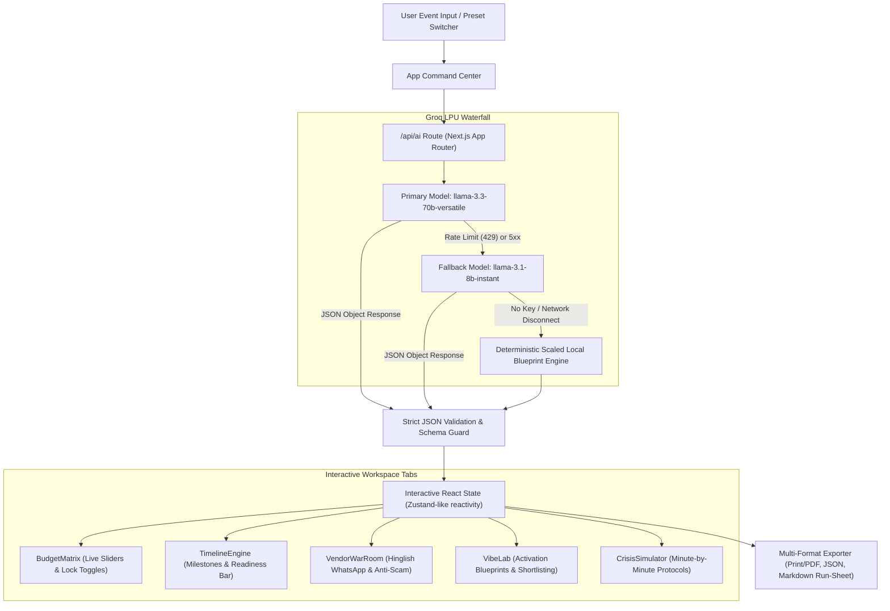

# VibeOps — Autonomous Event Production & Crisis War-Room
### *Hack2Skill PromptWars 2026 — Challenge 5: Celebration & Event Planner*

> **Transforming generative AI from generic chat "slop" into an autonomous, deterministic event production command center.** Powered by Groq LPUs (`llama-3.3-70b-versatile` with automatic `llama-3.1-8b-instant` fallback) for sub-second operational reasoning.

---

## 🎯 1. Problem Statement & The "Anti-Slop" Philosophy

Traditional generative AI chatbots fail catastrophic real-world tests when applied to event management:
1. **The "Text Dump" Trap:** Chatbots output massive, unstructured walls of text without mathematical validation, resulting in budgets that fail to sum up to 100% or unrealistic market numbers.
2. **Static Hallucinations:** When conditions change (e.g. rain at an outdoor venue, caterer delays, budget cuts), users must re-prompt from scratch without persistent state.
3. **Passive Advice vs. Actionable Operations:** A planner doesn't just need ideas; they need contractual red flags, anti-fraud checklists, WhatsApp vendor negotiation scripts in local Hinglish, and minute-by-minute contingency protocols.

**VibeOps eliminates "slop"** by wrapping open-weight LLMs in strict structured JSON schemas and binding them directly into an interactive, reactive operations deck. Every recommendation is interactive, editable, lockable, and real-time.

---

## ⚡ 2. Key Features Mapped to Challenge 5

| Challenge 5 Requirement | VibeOps War-Room Implementation | Technical Craft |
| :--- | :--- | :--- |
| **Multi-Track Event Architecture** | Dedicated orchestration for **Weddings**, **Birthdays**, and **Community Festivals** with regional Indian / Kashmiri nuances and global formats. | Multi-shot domain prompts, custom vibe palettes, and location-aware market rates. |
| **Budget Management & Catering Optimization** | **Zero-Sum Dynamic Budget Matrix** with interactive sliders, lock/unlock constraints, and a **Catering Waste Calculator**. | Live proportional visualization, automated 15% budget-slash action, and food waste buffer metrics. |
| **Schedule & Timeline Generation** | **Critical-Path Run-of-Show Timeline Engine** categorized by phase (Pre-Event vs Event Day) and criticality. | Interactive milestone status transitions, readiness progress bar, and custom milestone addition. |
| **Vendor Management & Negotiation** | **Vendor War-Room** with anti-fraud verification checklists, red flag contract warnings, and single-click procurement scripts. | Hinglish WhatsApp (`wa.me`) and formal RFQ email generators with live cost-savings calculation. |
| **Personalized Creative Ideas** | **Vibe Lab** offering high-impact, non-generic activations with impact scores and step-by-step SOP blueprints. | One-click "Shortlist into Event Plan" button that dynamically binds ideas into the production blueprint. |
| **Contingency & Crisis Management** | **Live Crisis & Chaos War-Room** with 1-click disaster injectors (monsoon flooding, power trips, chef emergencies, artist no-shows). | Minute-by-minute containment protocols, budget shock absorption delta, and ready-to-broadcast emcee scripts. |

---

## 🏗️ 3. GenAI System Architecture

VibeOps uses a resilient, high-speed LPU pipeline communicating with Groq's high-speed inference engine using native `fetch` and zero SDK bloat.



### Prompt Engineering Highlights:
- **Strict Multi-Shot Schemas:** Injected with real-world Indian & international market data (Srinagar Wazwan catering, Bangalore hackathon logistics, Delhi cocktail parties).
- **Zero-Sum Mathematical Validation:** Enforces proportional budget breakdowns with realistic contingencies.
- **Fail-Safe Offline Mode:** If evaluated in environments without outbound internet access or API credentials, VibeOps gracefully falls back to pre-compiled blueprints without a single broken screen.

---

## 🚀 4. Quick Start & Local Setup

### Prerequisites
- Node.js 18.17+ or Node.js 20+
- npm, yarn, or pnpm
- Free Groq API Key (Optional, get one at [console.groq.com](https://console.groq.com/keys))

### Installation
```bash
# 1. Clone the repository
git clone https://github.com/your-username/vibeops.git
cd vibeops

# 2. Install dependencies (ultra-lightweight, zero bloated SDKs)
npm install

# 3. Setup environment variables (Optional - instant demo presets work out of the box!)
cp .env.example .env.local
# Add your GROQ_API_KEY in .env.local

# 4. Launch the production dev server
npm run dev
```

Open [http://localhost:3000](http://localhost:3000) in your browser.

---

## 🎪 5. Hackathon Judge Evaluation Guide

To experience the full power of VibeOps in 2 minutes:

1. **Instant Demo Presets:** In the top navigation bar, click **"Demo Presets"** and toggle between:
   - 💒 *Royal Kashmiri Wedding* (₹25L budget, Wazwan buffer matrix, Mogul decor)
   - 🎮 *Cyberpunk 21st Birthday* (₹3.5L budget, neon LED tunnels, gaming battle)
   - 🚀 *500-PAX Tech & Community Fest* (₹8L budget, lightning talks, hackathon triage)
2. **Interactive Budget Equalizer:** Navigate to the **Budget Matrix** tab:
   - Drag any slider to reallocate funds live.
   - Click the 🔒 lock icon on "Venue" or "Catering".
   - Click **"AI Rebalance Unlocked Categories"** or **"AI Slash 15% Without Losing Vibe"** to see deterministic optimization in action.
3. **Vendor War-Room & Hinglish Scripts:** Navigate to the **Vendor War-Room** tab:
   - Check off anti-fraud items in the verification checklist.
   - Click **"Negotiation Script & WhatsApp"** to preview and test the ready-to-fire Hinglish WhatsApp message with direct `wa.me` integration.
4. **Trigger Live Chaos War-Room:** Click **"Crisis War-Room"** (or click "Simulate Chaos" from the timeline):
   - Click **"Torrential Rain & Outdoor Lawn Flooding"**.
   - Review the AI-generated minute-by-minute containment SOP, budget reallocation source, and copyable emcee announcement.
5. **Operational Export:** Click **"Export"** in the top bar to download the complete **Operational Run-Sheet Markdown (`.md`)**, download raw JSON, or trigger clean print-to-PDF.

---

## 📦 6. Repository Size & Standards Compliance

- **Repo Size:** Well under 10 MB limit (pure Vanilla CSS + Next.js App Router + lightweight Lucide icons).
- **TypeScript:** 100% strict type safety (`src/lib/types.ts`).
- **Zero Third-Party AI Bloat:** Uses native browser/Node `fetch` with official Groq OpenAI-compatible endpoints.
- **Design System:** Editorial Dark / Amber-Gold War-Room theme crafted with responsive CSS tokens, glassmorphism, and print stylesheet.

---

*Engineered with precision for Hack2Skill PromptWars 2026 Challenge 5.*
